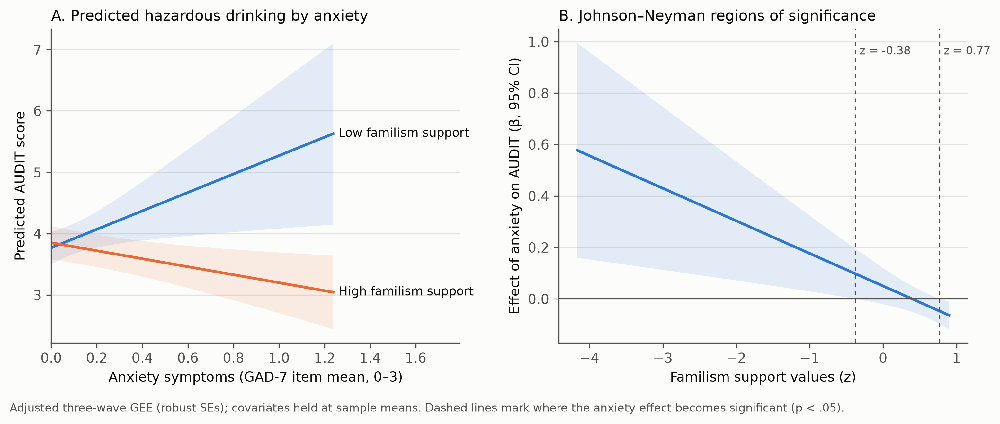

# Model 1 — Familism Support Values Moderate the Anxiety–Hazardous Drinking Association Among Latino/a Immigrants: A Three-Wave Longitudinal Study

*Recent Latino Immigrant Study (RLIS), Waves T5–T7. All estimates below were produced in Python with procedures matched to SPSS (GENLIN GEE, PROCESS v4 with HC3). They are to be verified step by step in SPSS with `spss_syntax/Model1_Anxiety_x_Familism_on_AUDIT.sps`; expect agreement to about the 2nd–3rd decimal.*

---

## 1. Rationale and gap

**Hazardous drinking in this cohort**
- Alcohol use among Latino/a immigrants tends to rise with time in the U.S.
- In RLIS, hazardous drinking (AUDIT ≥ 8) affects 16% of participants at T5, 9% at T6 and 16% at T7.
- The rate is 25% among men vs. 5% among women at T5.

**Anxiety as a pathway to drinking**
- Internalizing distress is a recognized pathway to hazardous drinking.
- In RLIS and related work, the focus has been on **depression** (Cabrera Tineo et al., in progress: depression × sex → alcohol) and on **immigration stress** (Cano et al., 2016).
- **Anxiety** has received little longitudinal attention in adult Latino/a immigrants.

**Familismo as a cultural protective factor**
- Familismo (valuing family closeness, loyalty and mutual support) is a core Latino cultural value.
- Prior RLIS work examined *pre-immigration* familismo as a main-effect protective factor (Dillon et al., 2013), and family *cohesion*, a family-functioning behavior (Cano et al., 2017).
- No study has tested whether current familism **values** change **how strongly anxiety is tied to hazardous drinking** in adult immigrants, or whether that pattern holds across repeated annual assessments.
- The only related test, in Latinx college students, found no moderation (see pilot study in reference list).

**The present study** tests this cultural-buffering hypothesis over three annual waves (518 adults, 1,554 person-waves).

---

## 2. Theoretical framework

Model 1 integrates three complementary frameworks.

| Framework | Core proposition | What it predicts for Model 1 |
|---|---|---|
| **Tension-Reduction Theory** (Conger, 1956) and the **Self-Medication Hypothesis** (Khantzian, 1997); drinking-to-cope motives (Cooper, 1994) | Alcohol is consumed to relieve aversive internal states; relief negatively reinforces drinking | Higher anxiety → more hazardous drinking (the *risk path*) |
| **Transactional Stress-and-Coping Model** (Lazarus & Folkman, 1984) and the **Stress-Buffering Hypothesis** (Cohen & Wills, 1985) | The effect of distress on health behavior depends on available coping resources; resources weaken (buffer) the distress → outcome link | A coping resource should *moderate* (weaken) the anxiety → drinking link |
| **Cultural Values / Familismo framework** (Sabogal et al., 1987; Knight et al., 2010; Stein et al., 2014), with **Social Control / Social Bond Theory** (Hirschi, 1969) | Familism values supply (a) a normative family obligation system that discourages behavior harmful to the family, and (b) a culturally sanctioned coping resource (turning to family rather than alcohol) | Familism support values are the culturally specific coping resource that buffers anxiety-related drinking |

**Integrated model.** Anxiety is a *risk factor* (tension reduction). Familism support values are a *culturally grounded protective resource* that changes the strength of that risk (stress-buffering plus familismo social control).

```
                Familism support values (MACVS)
                              │  (moderates; buffering)
                              ▼
   Anxiety symptoms (GAD-7) ─────────►  Hazardous drinking (AUDIT)
        [T5, T6, T7]                         [T5, T6, T7]
   Covariates: gender, age, household income, education, marital status,
   employment, documentation status, South/Central American origin; wave
```

---

## 3. Research questions and hypotheses

| # | Research question | Hypothesis |
|---|---|---|
| **RQ1** | Across three annual waves, are anxiety symptoms associated with hazardous drinking among Latino/a immigrants? | **H1:** Higher anxiety will be associated with higher AUDIT scores. |
| **RQ2** | Are familism support values associated with hazardous drinking? | **H2:** Higher familism support will be associated with lower AUDIT scores. |
| **RQ3 (primary)** | Do familism support values moderate the association between anxiety and hazardous drinking? | **H3:** Familism support will weaken (buffer) the positive anxiety–AUDIT association. |
| **RQ4** | Is the moderation robust: (a) after adjustment for sociodemographic covariates, (b) consistent across waves and gender, and (c) robust to alternative distributional assumptions for AUDIT? | **H4:** The anxiety × familism interaction will remain significant after adjustment, will not differ significantly across waves or by gender, and will hold in count (negative-binomial) and log-transformed models. |

---

## 4. Method

**Participants.**
- 518 adult Latino/a immigrants in Miami-Dade County, assessed annually at T5, T6 and T7 (n = 517, 504 and 493; 95.2% retained at T7).
- Baseline: M age = 35.2 years (SD = 5.1; range 24–51); 53.7% men; 68.3% married/partnered.
- Education: 48.3% more than high school. Employment: 79.7% employed. Documentation: 94.6% documented.
- Origin: 41.8% Cuban, 28.2% South American, 30.0% Central American.
- Median household income: $59,000 (IQR $25,000–$80,000).

**Measures.** Identical items and scoring were used at every wave.

| Construct | Instrument | Scoring | α T5 / T6 / T7 |
|---|---|---|---|
| Hazardous drinking | AUDIT, 10 items (Babor et al., 2001) | Sum 0–40 | .78 / .71 / .83 |
| Anxiety symptoms | GAD-7 (Spitzer et al., 2006) | Item mean 0–3 | .89 / .88 / .93 |
| Familism support values | MACVS Familism-Support, 6 items (Knight et al., 2010) | Item mean 1–5 | .88 / .89 / .81 |

**Covariates.** All covariates are baseline (T5) values:
- gender (male = 1)
- age (z-scored)
- ln household income (z-scored)
- education (> high school = 1)
- marital status (married/partnered = 1)
- employment (employed = 1)
- documentation status (documented = 1)
- South American and Central American origin (Cuban = reference)

**Analytic plan.**
1. **Data structure.** The data were restructured to person-period format (1,554 observations). All continuous variables were z-standardized (grand mean) and the interaction term zAnxiety × zFamilism was computed.
2. **Primary model.** Generalized estimating equations (GEE; Liang & Zeger, 1986; SPSS GENLIN) with an identity link, an exchangeable working correlation, robust (sandwich) standard errors, and wave dummies (T6, T7 vs. T5). Robust sandwich SEs are the heteroskedasticity-consistent estimator appropriate for repeated measures.
3. **Unadjusted and adjusted models.** Each model was estimated without and with the nine covariates.
4. **Probing the interaction.**
   - Simple slopes at ±1 SD of familism support.
   - Johnson–Neyman (J-N) regions of significance (Bauer & Curran, 2005).
   - Predicted AUDIT scores.
5. **Robustness.**
   - (a) Separate cross-sectional replications at T5, T6 and T7 using OLS with **HC3** standard errors (Long & Ervin, 2000; PROCESS Model 1; Hayes, 2022).
   - (b) Three-way tests of anxiety × familism × wave and anxiety × familism × gender.
   - (c) Negative-binomial GEE on raw AUDIT counts (log link; incidence-rate ratios, IRR).
   - (d) GEE on ln(AUDIT + 1).
6. **Multiple testing.** Candidate models were screened, so Benjamini–Hochberg FDR q-values are reported.
7. **Significance.** α = .05, two-tailed.

---

## 5. Results

### Table 1. Study variables by wave

| Variable | T5 M (SD) | T6 M (SD) | T7 M (SD) |
|---|---|---|---|
| AUDIT total (0–40) | 3.99 (3.76) | 3.54 (2.95) | 4.20 (3.97) |
| AUDIT ≥ 8 (hazardous), % | 16.0 | 8.9 | 15.8 |
| Anxiety, GAD-7 item mean (0–3) | 0.18 (0.38) | 0.16 (0.39) | 0.21 (0.49) |
| Familism support (1–5) | 4.59 (0.45) | 4.58 (0.48) | 4.50 (0.54) |
| n | 517 | 504 | 493 |

### Table 2. Within-wave correlations

| Pair | T5 | T6 | T7 |
|---|---|---|---|
| AUDIT – Anxiety | **.25*** | **.12**\*\* | −.05 |
| AUDIT – Familism support | **−.11**\* | .06 | **−.17*** |
| Anxiety – Familism support | −.07 | **−.09**\* | **.13**\*\* |

\*p < .05. \*\*p < .01. \*\*\*p < .001.

One-year stability: AUDIT r = .72 and .68; anxiety r = .26 and .13; familism r = .14 and −.05.

### Table 3. Three-wave GEE predicting hazardous drinking (z-AUDIT)

| Predictor | Unadjusted B (SE) | 95% CI | p | Adjusted B (SE) | 95% CI | p |
|---|---|---|---|---|---|---|
| Intercept | 0.022 (0.045) | −0.066, 0.109 | .628 | −0.334 (0.138) | −0.603, −0.064 | .015 |
| Anxiety (z) | 0.043 (0.032) | −0.020, 0.107 | .181 | 0.050 (0.036) | −0.020, 0.120 | .163 |
| Familism support (z) | −0.032 (0.021) | −0.073, 0.009 | .127 | −0.043 (0.022) | −0.086, −0.000 | **.048** |
| **Anxiety × Familism support** | **−0.115 (0.039)** | **−0.191, −0.038** | **.003** | **−0.127 (0.044)** | **−0.214, −0.040** | **.004** |
| Wave T6 (vs. T5) | −0.135 (0.032) | −0.197, −0.072 | < .001 | −0.130 (0.033) | −0.195, −0.066 | < .001 |
| Wave T7 (vs. T5) | 0.059 (0.046) | −0.031, 0.149 | .201 | 0.055 (0.047) | −0.038, 0.148 | .246 |
| Male (vs. female) | | | | 0.756 (0.069) | 0.621, 0.891 | < .001 |
| Married/partnered | | | | −0.140 (0.078) | −0.293, 0.014 | .074 |
| Documented | | | | 0.013 (0.091) | −0.166, 0.192 | .886 |
| Education > high school | | | | −0.153 (0.072) | −0.294, −0.013 | .032 |
| Employed | | | | 0.102 (0.081) | −0.057, 0.261 | .210 |
| South American (vs. Cuban) | | | | 0.022 (0.078) | −0.131, 0.176 | .774 |
| Central American (vs. Cuban) | | | | 0.018 (0.087) | −0.153, 0.189 | .834 |
| Age (z) | | | | −0.063 (0.034) | −0.130, 0.004 | .065 |
| Household income, ln (z) | | | | 0.100 (0.029) | 0.043, 0.158 | .001 |
| Observations / participants | 1,511 / 518 | | | 1,418 / 485 | | |
| Working correlation (exchangeable) | .61 | | | .49 | | |

*Note.* B values are standardized (z-scored outcome and continuous predictors). Robust sandwich SEs. Wald χ²(1) for the interaction: 8.68 (unadjusted) and 8.16 (adjusted).

### Table 4. Probing the interaction (adjusted model; unadjusted in parentheses)

| Familism support | Simple slope of anxiety, β (SE) | 95% CI | p |
|---|---|---|---|
| Low (−1 SD) | **0.177** (0.075) [unadj. 0.158] | 0.030, 0.324 | **.018** [.015] |
| Mean | 0.050 (0.036) [0.043] | −0.020, 0.120 | .163 [.181] |
| High (+1 SD) | **−0.077** (0.030) [unadj. −0.071] | −0.135, −0.019 | **.010** [.018] |

**Johnson–Neyman regions (adjusted):**
- Anxiety is **significantly positively** associated with AUDIT when familism support is **below z = −0.37** (33.6% of observations).
- It is **significantly negatively** associated when familism support is **above z = 0.78** (42.0%).
- There is no significant association between those values.

**Predicted AUDIT scores** (adjusted; covariates at their means):

| Familism support | Anxiety −1 SD | Anxiety +1 SD | Change |
|---|---|---|---|
| Low (−1 SD) | 3.41 | 4.68 | +1.27 points |
| High (+1 SD) | 4.01 | 3.46 | −0.55 points |



*Figure 1.* (A) Predicted AUDIT scores across anxiety at low vs. high familism support. (B) Johnson–Neyman plot of the conditional effect of anxiety across familism support. Adjusted GEE; shaded bands are 95% CIs.

### Table 5. Robustness of the Anxiety × Familism interaction

| Test | Unadjusted | Adjusted |
|---|---|---|
| Primary GEE (z-AUDIT), B (p) | −0.115 (.003) | −0.127 (.004) |
| Negative-binomial GEE, IRR (p) | 0.938 (.004) | **0.925 (< .001)** |
| GEE on ln(AUDIT+1), p | < .001 | < .001 |
| Per-wave OLS-HC3, T5: B (p) | −0.142 (.048) | −0.178 (.004) |
| Per-wave OLS-HC3, T6: B (p) | −0.166 (.006) | −0.094 (.070) |
| Per-wave OLS-HC3, T7: B (p) | −0.232 (.113) | −0.230 (.132) |
| Anxiety × Familism × Wave, Wald χ²(2) (p) | 0.73 (.695) | 2.33 (.312) |
| Anxiety × Familism × Gender, B (p) | 0.026 (.746) | 0.060 (.476) |
| FDR q (distress × buffer family) | .039 | .077 |

### 5.1 Hypothesis summary

| Hypothesis | Result | Supported? |
|---|---|---|
| H1: Anxiety → higher AUDIT | Not at average familism (β = .05, ns); positive only at low familism | **Partially** (conditional on familism) |
| H2: Familism → lower AUDIT | β = −.043, p = .048 adjusted (ns unadjusted) | **Partially** (adjusted only) |
| H3: Familism buffers anxiety → AUDIT | β = −.127, p = .004 adjusted; −.115, p = .003 unadjusted | **Supported** |
| H4: Robust and consistent | Holds in NB and log models; same sign at all waves; no wave or gender differences | **Largely supported** (single-wave tests significant at T5 only when adjusted) |

---

## 6. Results text (APA style, ready to adapt)

> Across the three waves, hazardous drinking averaged 3.99, 3.54 and 4.20 on the AUDIT, with 16.0%, 8.9% and 15.8% of participants scoring in the hazardous range (≥ 8). In the unadjusted GEE, neither anxiety (β = 0.04, p = .181) nor familism support values (β = −0.03, p = .127) was associated with hazardous drinking on average. However, the anxiety × familism support interaction was significant (β = −0.115, SE = 0.039, 95% CI [−0.191, −0.038], Wald χ²(1) = 8.68, p = .003).
>
> The interaction remained significant after adjusting for gender, age, household income, education, marital status, employment, documentation status and region of origin (β = −0.127, SE = 0.044, 95% CI [−0.214, −0.040], Wald χ²(1) = 8.16, p = .004). In this model, familism support was also associated with lower hazardous drinking (β = −0.043, p = .048). Men (β = 0.756, p < .001) and participants with higher household income (β = 0.100, p = .001) reported more hazardous drinking; those with more than a high-school education reported less (β = −0.153, p = .032).
>
> Simple-slope analyses showed that anxiety was positively associated with hazardous drinking among participants with low familism support (−1 SD: β = 0.177, 95% CI [0.030, 0.324], p = .018). Among those with high familism support, the association was reversed (+1 SD: β = −0.077, 95% CI [−0.135, −0.019], p = .010). Johnson–Neyman analysis showed a significant positive association when familism support fell below z = −0.37 (33.6% of observations) and a significant negative association above z = 0.78 (42.0%). In raw units, moving from low to high anxiety corresponded to a 1.27-point increase in AUDIT at low familism support and a 0.55-point decrease at high familism support.
>
> The moderation did not differ across waves (anxiety × familism × wave, Wald χ²(2) = 2.33, p = .312) or by gender (β = 0.060, p = .476). It was robust to negative-binomial modeling of raw AUDIT counts (IRR = 0.925, p < .001) and to log-transformation of AUDIT (p < .001). In separate wave-specific regressions with HC3 standard errors, the interaction was negative at every wave (T5 β = −0.178, p = .004; T6 β = −0.094, p = .070; T7 β = −0.230, p = .132).

---

## 7. Discussion points

1. **Culture changes the risk.** Anxiety was not a uniform risk factor. It was linked to hazardous drinking only among immigrants who endorsed familism support values weakly, which is consistent with a cultural stress-buffering process.
2. **Mechanism.** Strong familism values may:
   - redirect coping toward family support rather than alcohol (a coping substitution);
   - impose family-based normative constraints on drinking to cope (social control);
   - reduce the negative-reinforcement value of alcohol.
   Drinking-to-cope motives would be the natural mediator to test in future work.
3. **Reversal at high familism.** The negative slope at high familism may reflect anxious individuals with strong family orientation withdrawing from drinking contexts, or anxiety about family obligations acting as a restraint. Interpret this cautiously.
4. **Intervention implications.** Culturally adapted alcohol interventions for anxious Latino/a immigrants could deliberately mobilize familism values, for example family-involved brief interventions or motivational interviewing that draws on family responsibility.
5. **Extending prior RLIS work.** This moves beyond pre-immigration familismo (Dillon et al., 2013) and family cohesion (Cano et al., 2017) by showing that *current familism values* condition *anxiety-related* drinking over time.

## 8. Limitations to report

- **Concurrent associations, not prediction.** The GEE estimates within-wave associations pooled across waves; they are not prospective effects. The low one-year stability of anxiety and familism limits cross-lagged inference. Avoid causal language.
- **Per-wave power.** Single-wave replications were individually significant only at T5 (adjusted). The consistent sign and the non-significant three-way wave test support pooling.
- **Effect size.** The effect is small in standardized terms (β ≈ −.13), though meaningful in AUDIT points at the extremes.
- **Low anxiety levels.** Anxiety was low on average and right-skewed (GAD-7 ≥ 10 in only 2–5%), and familism support showed a ceiling effect (M ≈ 4.5 of 5).
- **Self-report.** AUDIT and all predictors are self-reported. Documentation status is highly unbalanced (5.4% undocumented).
- **Multiple testing.** The model was selected from a screen of candidate models; the FDR q is .039 unadjusted and .077 adjusted, and this should be disclosed.

## 9. Novelty statement

A literature search (PubMed, Google Scholar, publisher sites) and the RLIS portfolio found **no study testing familism values as a moderator of the anxiety–hazardous drinking association in adult Latino/a immigrants, and none longitudinally.** The closest work:
- Dillon et al. (2013): pre-immigration familismo as a main effect.
- Cano et al. (2017): family cohesion.
- A 2025 college-student pilot: null moderation of bicultural stress.
- Cabrera Tineo et al. (in progress): depression × sex.

## 10. References

- Babor, T. F., Higgins-Biddle, J. C., Saunders, J. B., & Monteiro, M. G. (2001). *AUDIT: The Alcohol Use Disorders Identification Test* (2nd ed.). World Health Organization.
- Bauer, D. J., & Curran, P. J. (2005). Probing interactions in fixed and multilevel regression. *Multivariate Behavioral Research, 40*(3), 373–400.
- Benjamini, Y., & Hochberg, Y. (1995). Controlling the false discovery rate. *Journal of the Royal Statistical Society: Series B, 57*(1), 289–300.
- Cano, M. Á., Sánchez, M., Rojas, P., Ramírez-Ortiz, D., Polo, K. L., Romano, E., & De La Rosa, M. (2017). Alcohol use severity among adult Hispanic immigrants: Examining the roles of family cohesion, social support, and gender. *Substance Use & Misuse, 53*(4), 668–676.
- Cano, M. Á., Sánchez, M., Trepka, M. J., et al. (2016). Immigration stress and alcohol use severity among recently immigrated Hispanic adults. *Journal of Clinical Psychology, 73*(3), 294–307.
- Cohen, S., & Wills, T. A. (1985). Stress, social support, and the buffering hypothesis. *Psychological Bulletin, 98*(2), 310–357.
- Conger, J. J. (1956). Reinforcement theory and the dynamics of alcoholism. *Quarterly Journal of Studies on Alcohol, 17*, 296–305.
- Cooper, M. L. (1994). Motivations for alcohol use among adolescents: Development and validation of a four-factor model. *Psychological Assessment, 6*(2), 117–128.
- Dillon, F. R., De La Rosa, M., Sastre, F., & Ibañez, G. (2013). Alcohol misuse among recent Latino immigrants: The protective role of preimmigration familismo. *Psychology of Addictive Behaviors, 27*(4), 956–965.
- Hayes, A. F. (2022). *Introduction to mediation, moderation, and conditional process analysis* (3rd ed.). Guilford.
- Hirschi, T. (1969). *Causes of delinquency*. University of California Press.
- Khantzian, E. J. (1997). The self-medication hypothesis of substance use disorders: A reconsideration and recent applications. *Harvard Review of Psychiatry, 4*(5), 231–244.
- Knight, G. P., Gonzales, N. A., Saenz, D. S., Bonds, D. D., Germán, M., Deardorff, J., Roosa, M. W., & Updegraff, K. A. (2010). The Mexican American Cultural Values Scale for adolescents and adults. *Journal of Early Adolescence, 30*(3), 444–481.
- Lazarus, R. S., & Folkman, S. (1984). *Stress, appraisal, and coping*. Springer.
- Liang, K.-Y., & Zeger, S. L. (1986). Longitudinal data analysis using generalized linear models. *Biometrika, 73*(1), 13–22.
- Long, J. S., & Ervin, L. H. (2000). Using heteroscedasticity consistent standard errors in the linear regression model. *The American Statistician, 54*(3), 217–224.
- Sabogal, F., Marín, G., Otero-Sabogal, R., Marín, B. V., & Pérez-Stable, E. J. (1987). Hispanic familism and acculturation: What changes and what doesn't? *Hispanic Journal of Behavioral Sciences, 9*(4), 397–412.
- Spitzer, R. L., Kroenke, K., Williams, J. B. W., & Löwe, B. (2006). A brief measure for assessing generalized anxiety disorder: The GAD-7. *Archives of Internal Medicine, 166*(10), 1092–1097.
- Stein, G. L., Cupito, A. M., Mendez, J. L., Prandoni, J., Huq, N., & Westerberg, D. (2014). Familism through a developmental lens. *Journal of Latina/o Psychology, 2*(4), 224–250.
- Pilot study (2025): *A pilot study examining bicultural stress, internalizing problems, alcohol use, and familism's moderating role in Hispanic/Latinx college students*. *Journal of American College Health*. https://pubmed.ncbi.nlm.nih.gov/40138516/ — verify authors before citing.

*Verify all citation details against the original sources before submission.*
